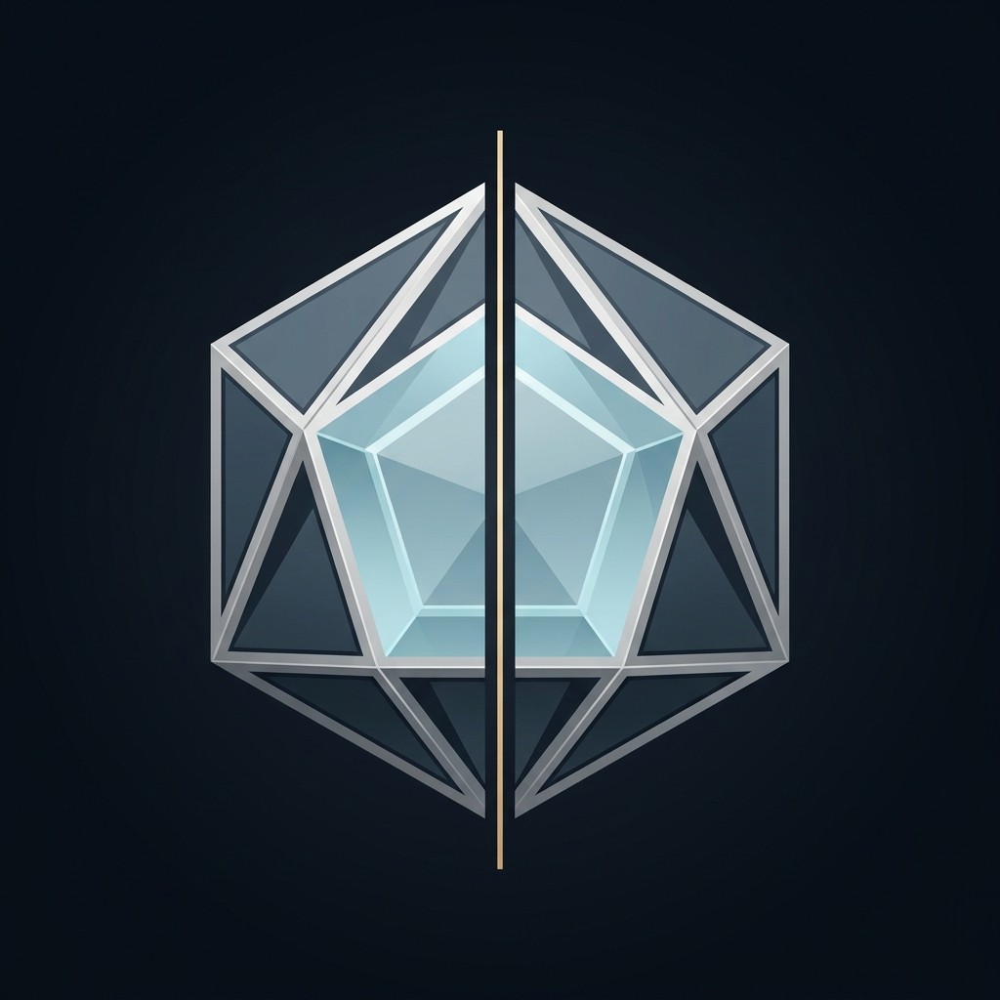

<p align="center">
  
</p>

# Quintessentia

<p align="center">
  <a href="LICENSE"></a>
</p>

**Quintessentia** is a local inference engine for **Hugging Face and GGUF language models** built around **pure Q1 binary-halving cubes (V4)**, unified **4-layer multi-scale balance (M0–M8 + KV)**, self-contained **NVRTC CUDA kernels**, hybrid VRAM/pinned-RAM KV caching, a live **Windows/WSL 2 Desktop HUD**, and an OpenAI-compatible LAN server.

> **Default CUDA runtime (`V4` / `--weight-format auto`):** On NVIDIA GPUs, Quintessentia automatically runs checkpoints through pure **Q1 binary-halving cubes** (`q1_cubes`, `root_bits=8`) with bidirectional mirror-balance depth auto-fit (`k=5` default, stepping down `4->3` under tight VRAM or refining up to `k=8` for compact models fitting inside `<= 35%` VRAM budget), 4-layer solver-free balance across all runtime scales (`M0–M8`, hybrid KV placement, and chunked prefill), bank-conflict-free NVRTC CUDA kernels, and zero-OOM adaptive streaming.
>
> **Validated across 39 / 45 present local checkpoints (3-turn isolated suite per model, 0 OOM, 0 crashes)** on a single **8 GB RTX 3060 Ti** (WSL 2 native ext4): from **124M–350M** (`48–106 tok/s`) and **1B** (`39–41 tok/s`) to **2B–4B MLA/BitNet/VLM** (`6.7–22.5 tok/s`), **7B–9B BF16** fully resident in 5.86–5.95 GiB (`18.9–19.8 tok/s`), **20B MXFP4 MoE** in 3.77 GiB, and **35B 256-expert MoE** in 5.40 GiB (`3.3 tok/s`). Explicit `q1`, `q2`, `q4`, `q6`, `q8`, `bf16`, `--feedback-mode off`, and `--device cpu` modes remain available; see [model support](MODEL_SUPPORT.md) for the complete 3x per-checkpoint matrix.

<a href="https://buymeacoffee.com/silentfish">
  
</a>


## Requirements

- Optional NVIDIA GPU with CUDA (tested: RTX 3060 Ti 8 GB; smaller budgets use adaptive streaming while still requiring room for individual operators). CPU-only execution is available with `--device cpu`.
- Python 3.12, PyTorch with CUDA 12.4 / 12.6 (`requirements.txt`)
- Linux / WSL 2 (recommended for native `ext4` fast I/O, `os.pread()`, `O_DIRECT`, and bundled `nvidia-cuda-nvrtc` discovery) or Windows x64

```bash
python -m venv .venv
.venv/Scripts/python -m pip install torch==2.6.0 --index-url https://download.pytorch.org/whl/cu124
.venv/Scripts/python -m pip install -r requirements.txt
```

## Model

Choose a tested checkpoint from [model support](MODEL_SUPPORT.md). Standard Hugging
Face shards (`model-0000X-of-0000N.safetensors` + `model.safetensors.index.json`),
single `.safetensors` checkpoints, and single or split `.gguf` files are read directly
with positioned I/O (`zero mmap`) — no manual converter and no second full copy on disk.

```bash
./quint download https://huggingface.co/HuggingFaceTB/SmolLM2-135M-Instruct
```

You can point `--model` at a local folder or place checkpoints in `models/`. Original
checkpoint files are never modified. For MoE checkpoints, routed expert slices are read
on demand rather than loading all experts into memory.

Supported input weight encodings adapted on the fly into Q1 cubes (or explicit runtime formats):
- **Hugging Face `.safetensors`:** BF16/FP16, block FP8, AWQ GEMM INT4, GPTQ INT4, bitsandbytes 8-bit (`SCB`, without requiring `bitsandbytes`), and packed MXFP4 MoE experts.
- **GGUF (single or split shards):** standard and K/I-quant blocks (`Q2_K`, `Q3_K_M`, `Q4_0`, `Q4_1`, `Q4_K_M`, `Q5_*`, `Q6_K`, `Q8_*`, `IQ1_S`..`IQ4_NL`, `TQ1_0`/`TQ2_0`, and native `bitnet.cpp` `I2_S` type 36) across 35+ GGUF families without the external `gguf` PyPI package.
- **Architectures covered:** Dense Transformers (`Llama`, `Qwen2/3/3.5`, `Qwen2-VL` text, `Gemma 2/3`, `Phi-3/4`, `Cohere2`, `OLMo2`, `Nemotron`, `Granite`, `SmolLM3`, `ERNIE-4.5`, `BitNet-b1.58`, `GPT-2 Conv1D`, `GPT-NeoX`, `BLOOM`), MLA (`MiniCPM3`), pure SSM (`Mamba`, `Mamba2`), hybrid SSM/Attention/Griffin (`Zamba2`, `Falcon-H1`, `RecurrentGemma`, `LFM2`), and sparse/hybrid MoE (`Qwen3.5/3.6-MoE`, `Granite-MoE`, `Granite-4.0-Hybrid`, `GPT-OSS MXFP4`).

An adapter or recognized architecture ID is not a blanket guarantee that every checkpoint
of that family works. Multimodal checkpoints, where usable, expose only the language
portion; image/audio inference is not provided. Legacy pickle `.bin` checkpoints and
repositories requiring `trust_remote_code` are outside the validated scope.

- **`--weight-format auto` (default):** on CUDA, selects pure **Q1 cubes V4** (`q1_cubes`, `k=5`, `root_bits=8`) automatically across both dense and MoE models. On `--device cpu` (or without CUDA), uses the standard CPU streaming path.
- **Explicit formats & opt-out:** `--q1-planes N` (`1..16`) adjusts Q1 bit-plane depth; `--feedback-mode off` opts out to the legacy `auto` selector (specialized Qwen3.5 Q4 or universal Q6); explicit `--weight-format q1|q2|q4|q6|q8|bf16` is always respected.
- Self-contained NVRTC CUDA kernels handle Q1 bit-plane GEMV/carving as well as supported DeltaNet, causal convolution, and RMSNorm operations without Triton or `causal-conv1d`.

## Usage

One-button launchers pick the local environment automatically: `./quint` on Linux / WSL 2, `.\quint.cmd` or `.\quintessentia.cmd` on Windows, or `python quintessentia.py`.

```bash
./quint doctor                                                # GPU, model, V4 Q1 + RSSF balance plan, HUD, LAN
./quint models                                                # numbered local model catalog
./quint ask --model 1 "Hello"                                 # default V4 Q1 cubes + anti-loop profile
echo "Summarize this" | ./quint ask --model 1 --no-think      # piped stdin prompt support
./quint ask --model 1 --q1-planes 6 --no-think "Explain..."   # explicit Q1 depth, direct answer
./quint ask --model 1 --mode custom --temperature 0 "Hi"      # manual greedy sampling control
./quint bench --model 1 --runs 3                              # multi-run throughput, KV reuse & balance benchmark
./quint chat                                                  # multi-turn chat (/balance, /hud, /reset, /stats)
./quint serve --hud                                           # web chat + OpenAI API on :8787 + live Desktop HUD
./quint hud                                                   # launch Desktop HUD widget (Windows Native & WSL 2)
./quint hud --status | --stop | --install-desktop             # HUD status JSON, instant stop, or Desktop install
./quint discover                                              # find Quintessentia servers on the LAN
```

- **`--mode default` (default):** unlimited output until natural EOS (`--max-tokens 0`) with anti-loop GPU sampling tuned separately for `<think>` and `--no-think`. Any explicit sampling flag (`--temperature`, `--top-p`, `--top-k`, `--presence-penalty`, `--repetition-penalty`, `--seed`) overrides the profile.
- **`--mode custom`:** raw manual control (deterministic greedy unless sampling flags are passed).

### Model downloads and preparation

`models` accepts `--json` and `--check`. The latter checks adaptation metadata;
it does not run generation or certify support. Choose with `--model NUMBER`, a
catalog folder name or a full path. Plain listing and command help do not initialize PyTorch or CUDA.

```bash
./quint download https://huggingface.co/HuggingFaceTB/SmolLM2-135M-Instruct --directory "./models/SmolLM2-135M"
./quint ask --model "./models/SmolLM2-135M" "What is 6 times 7?"
./quint prepare --model "./models/SmolLM2-135M"
```

`download` defaults to `models/OWNER__REPO`, registers external destinations in the
local catalog, and performs a finite first-forward check with automatic runtime adaptation.
Its `quintessentia-source.json` records `ready`, an unverified download, or a failure.
`--no-verify` skips that forward. Repository IDs, model-page URLs, revision pages, and
GGUF file URLs (`--file path/model.gguf` or `OWNER/REPO::path/model.gguf`) are accepted;
numbered split GGUF shards are downloaded together.

### VRAM modes

Quintessentia measures the **free** VRAM at start and plans with it — there are no fixed card profiles.
When NVML is available it matches the CUDA device by UUID and uses the lower CUDA/NVML
free reading, so another process's allocation enters the startup budget.

| Mode | What it takes |
|---|---|
| `--vram-mode normal` (default) | most free VRAM, keeping a reserve for the OS, KV/recurrent state of `--max-context` tokens, and prefill workspace |
| `--vram-mode turbo` | all free VRAM with a minimal reserve |

If the model fits in VRAM, every layer stays resident. When weights exceed available VRAM,
V4 `q1_cubes` streams remaining trunk layers and routed MoE experts dynamically within the
available GPU/host/disk budget without OOM. Legacy `bf16`/`q4`/`q6` modes retain the bounded
rotating-slot ring pipeline.

Requests exceeding `--max-context` (prompt + requested output) are rejected before prefill
rather than silently truncating history. Prompts are prefilled in chunks (`--prefill-chunk`,
default 512 tokens), projecting only the last position onto vocabulary logits where supported.

### LAN server

| Endpoint | |
|---|---|
| `POST /v1/chat/completions` | OpenAI-compatible, JSON or `stream: true` SSE (`reasoning_content` for `<think>`) |
| `POST /v1/chat/stop` | stops the running generation immediately |
| `GET /v1/models`, `GET /api/info` | model list, backend/format, context length (`/api/v0/models`, `/props`, `/api/extra/true_max_context_length`), node status |
| `GET /` | built-in zero-CDN web chat |

- One generation runs at a time. A new request — or a disconnected client, detected even during prefill — cancels the running one and frees VRAM before starting the next (`--no-preempt` queues instead).
- Request bodies above `--max-request-bytes` (default 8 MiB) return HTTP 413.
- `--require-auth` enforces a Bearer API key (open on LAN by default).
- Server logs rotate in `logs/server.log` (10 MB × 5; `--log-file`, `--no-log-file`).

## Accuracy and speed

### Q1 Cubes V4 + 4-Layer RSSF Balance (`--weight-format auto`) — 2026-11-26

Measured live on **NVIDIA GeForce RTX 3060 Ti 8 GB** (WSL 2 native `ext4`, isolated 3-turn suite per checkpoint: cold factual `R1`, KV/SSM continuation `R2`, post-reset structured `R3`; peak decode throughput & peak VRAM):

| Scale | Checkpoint | Disk | Q1 / Placement | Best Decode | Peak VRAM | Notes |
|---|---|---:|---|---:|---:|---|
| 124M | `37_hf_gpt2-124m` (`Conv1D`) | 0.51 GiB | `k=8` 12/12 res | **106.3 tok/s** | 225 MiB | Auto-refined `k=8` native `Conv1D` |
| 350M | `15_gguf_LFM2-350M-Q4_K_M` | 0.21 GiB | `k=8` 16/16 res | **48.2 tok/s** | 490 MiB | Clean 3/3, `kv2_hit=30` |
| 1B | `01_gguf_Llama-3.2-1B-Instruct-Q4_K_M` | 0.75 GiB | `k=8` 16/16 res | **39.2 tok/s** | 1,391 MiB | Clean 3/3, `kv2_hit=56` |
| 1.2B Hybrid | `31_hf_Zamba2-1.2B-instruct-v2` | 2.27 GiB | `k=8` 38/38 res | **17.1 tok/s** | 1,478 MiB | Shared transformer + Mamba2 (`kv2_hit=31`) |
| 2B Ternary | `25_gguf_BitNet-b1.58-2B-i2_s` | 1.11 GiB | `k=6` 30/30 res | **17.0 tok/s** | 2,108 MiB | Native `bitnet.cpp` `I2_S` (type 36) |
| 2B VLM Text | `41_hf_Qwen2-VL-2B-Instruct-AWQ` | 2.74 GiB | `k=8` 28/28 res | **21.2 tok/s** | 1,669 MiB | 1D-mRoPE-equivalent `Qwen2` AWQ text |
| 2B Griffin | `33_hf_recurrentgemma-2b-it-8bit` | 3.15 GiB | `k=6` 26/26 res | **22.5 tok/s** | 2,372 MiB | Direct 8-bit `SCB` -> Q1 cubes |
| 4B MLA | `10_gguf_MiniCPM3-4B-MLA-Q4_K_M` | 2.30 GiB | `k=5` 62/62 res | **6.7 tok/s** | 2,943 MiB | Full 62-layer compressed MLA KV (`kv2_hit=26`) |
| 7B | `08_gguf_command-r7b-12-2024-IQ3_XS` | 3.47 GiB | `k=5` 32/32 res | **19.8 tok/s** | 5,953 MiB | Fully resident in 5.95 GiB, crisp EOS |
| 9B BF16 | `Qwythos-9B-v2-MTP-BF16` (`k=5`) | 17.14 GiB | `k=5` 32/32 res | **18.9 tok/s** | 5,861 MiB | Full 9B BF16 resident; `60K` `13.06`, `80K` `10.17 tok/s` |
| 20B MoE | `45_hf_gpt-oss-20b-MXFP4` | 12.84 GiB | `k=5` 24/24 + MoE | **1.0 tok/s** | 3,772 MiB | Packed MXFP4 experts on demand (`kv2_hit=127`) |
| 35B MoE | `Qwen3.6-35B-A3B` (256 experts) | 23.87 GiB | `k=5` 40/40 + MoE | **3.3 tok/s** | 5,404 MiB | +73% vs 2.0.0 (`1.91 tok/s`), `kv2_hit=32`, 0 OOM |

- **Reconstruction precision:** Q1 binary-halving cubes are progressive and lossy at low plane counts (`k=4..6`), converging monotonically toward source weights as `k` increases (single-layer cosine similarity on 9B BF16: `0.9961` at `k=4`, `0.9991` at `k=5`, `0.9998` at `k=6`, `1.0000` at `k=16`). Source quantization quality still caps final output quality (for example, ultra-low-bit source GGUFs like `IQ1_S` cannot be recovered beyond their stored weights).
- **Release validation & historical baselines:** see [model_support_2_1_0.json](benchmarks/model_support_2_1_0.json) for 2.1.0, [RELEASE_2_0_0.md](benchmarks/RELEASE_2_0_0.md) and [model_support_2_0_0.json](benchmarks/model_support_2_0_0.json) for 2.0.0, and [RELEASE_1_1_0.md](benchmarks/RELEASE_1_1_0.md), [RELEASE_1_2_0.md](benchmarks/RELEASE_1_2_0.md), and [STREAMING_DECODE_20261118.md](benchmarks/STREAMING_DECODE_20261118.md) for historical Q4/Q6 baselines.

## CPU execution, speculation, and optional modes

- **CPU-only / progressive startup:** `--device cpu` runs without CUDA. When using legacy formats (`--feedback-mode off` or explicit `q4`/`q6`/`bf16`), `--progressive-start` (default) lets CPU and GPU preparation proceed in parallel (`--no-progressive-start` selects GPU-first). Direct CUDA `q1_cubes` starts straight on GPU.
- **Speculation (`--speculation auto|off|lookup|native|q1`):** supports prompt lookup, optional trained Qwen3.5 MTP head (`--mtp-head`), and Q1 draft verification with state rollback for rejected tokens.
- **Thought buffer (`--thought-anchor`):** opt-in bounded probability-field anchoring across multi-turn synthesis (off by default).
- **Wavefront prefill (`--prefill-wavefront`):** opt-in experimental chunk-pipelined prefill for Llama models under legacy BF16/Q4/Q6.

## Tests

```bash
python -m pytest tests -q
```

CPU tests run anywhere; CUDA and model-dependent tests run automatically when an NVIDIA GPU and local checkpoints are present.

## License & acknowledgments

Quintessentia is an independent project licensed under [Apache-2.0](LICENSE), with gratitude to the two projects that inspired its initial direction:

- **AirLLM:** Gavin Li and contributors — [original project](https://github.com/lyogavin/airllm).
- **Colibrì:** Vincenzo Fornaro / JustVugg and contributors — [original project](https://github.com/JustVugg/colibri).

Upstream names and marks do not imply endorsement; see [NOTICE](NOTICE), [asset sources](assets/README.md), and [CHANGELOG.md](CHANGELOG.md).
